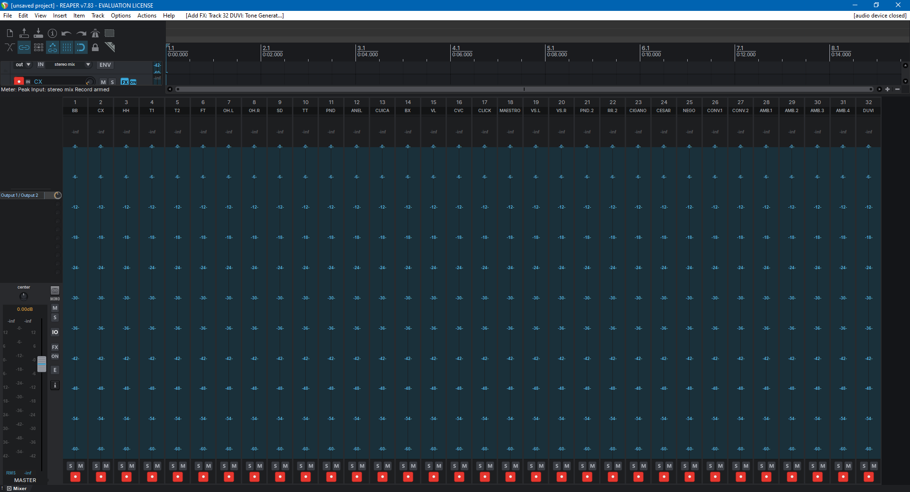
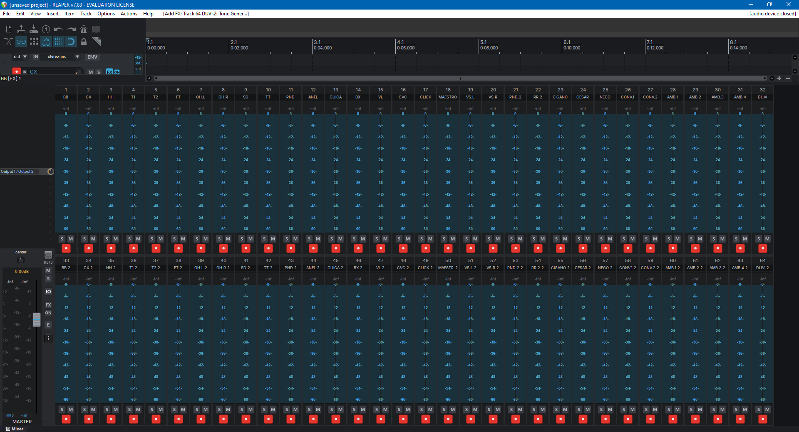
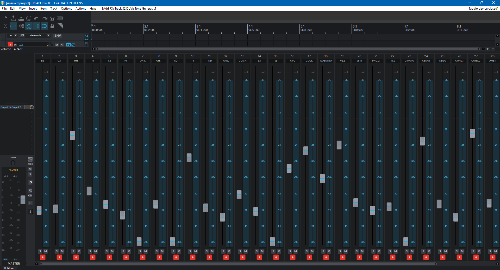
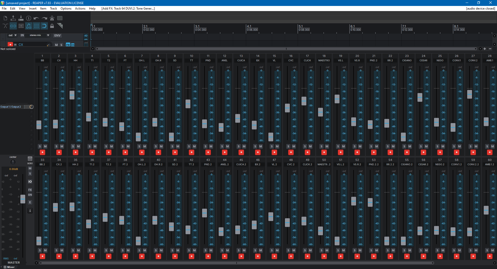
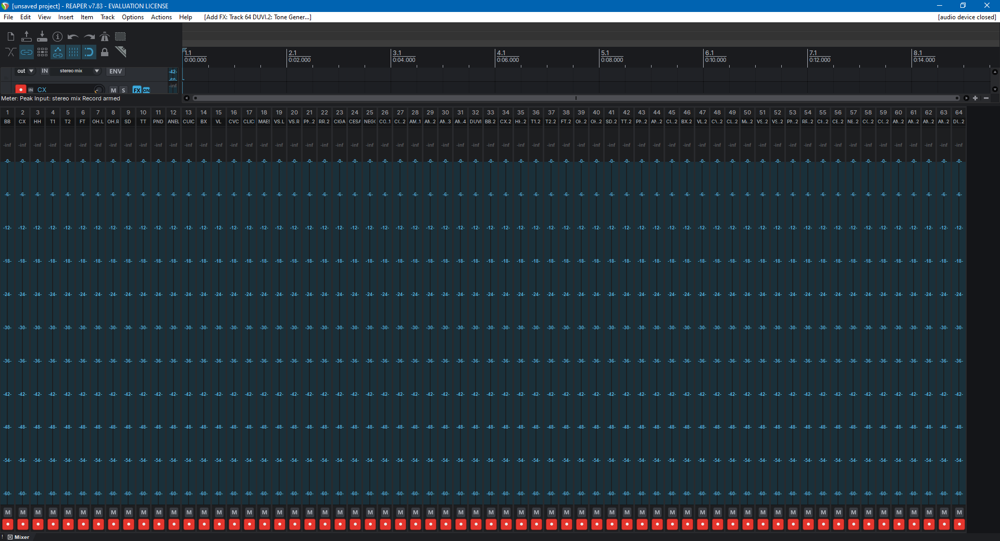
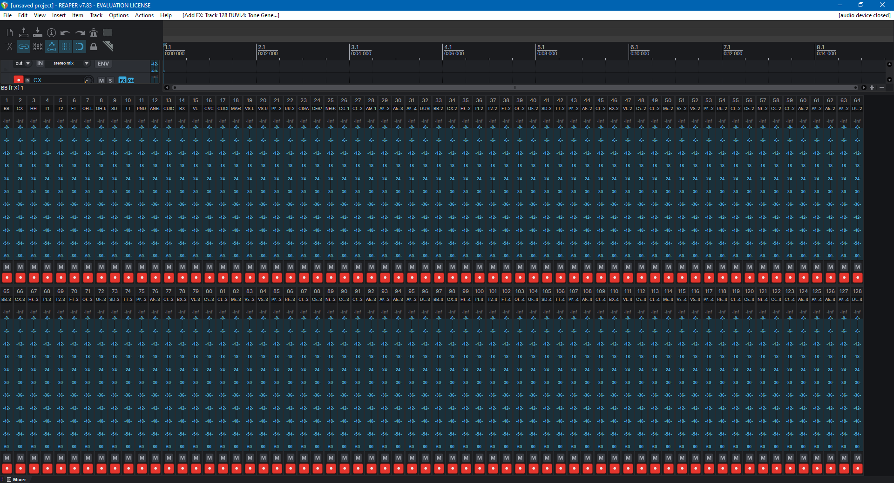

Created by [@lucas.silva.audio](https://www.instagram.com/lucas.silva.audio/)

# Default 7.0 Compact Mixer — REAPER theme

A REAPER 7 theme built on the stock **Default 7.0** layout with compact,
Classic-1.x-style mixer strips, so dozens of tracks fit on one screen in
two or more rows. Since v1.3 it wears the **LiveRig** visuals: dark charcoal
panels, flat LiveRig buttons, faders and knobs, and blue meters — with every
control at exactly the size and position of Default 7.0.

## Download

**[⬇ Download Default_7.0_Compact_Mixer_v1.3.ReaperThemeZip](https://github.com/Proveyron/reaper-classic-mixer-theme/releases/download/v1.3/Default_7.0_Compact_Mixer_v1.3.ReaperThemeZip)** (v1.3)

Newer and older versions are on the [Releases page](https://github.com/Proveyron/reaper-classic-mixer-theme/releases/latest).
The file name carries the version, so each version shows up in REAPER's theme
list as **Default_7.0_Compact_Mixer_v&lt;version&gt;**.

## Install

1. Download `Default_7.0_Compact_Mixer_v1.3.ReaperThemeZip`.
2. In REAPER: **Options → Themes → Load theme…** and pick the file
   (or drag it onto the REAPER window).
3. Open the mixer (`Ctrl+M`). With **Show multiple rows of tracks when size
   permits** enabled in the mixer menu, tracks wrap into rows.

## Mixer layouts

The mixer gets three layouts (each also in 150% and 200%): right-click a mixer
strip → **Layout**. The track panel, transport, envelopes and master keep the
Default 7.0 layout.

| Layout | Strip | Contents (top → bottom) |
|---|---|---|
| **Classic compact** (default) | 54 px | channel number, track name, 51 px meter with peak readout and dB scale, solo + mute, rec arm |
| **Classic compact fader** | 64 px | same, with a 24 px volume fader to the left of a narrower meter |
| **Classic ultra compact** | 29 px | channel number, track name, 26 px meter, mute, rec arm (no solo) |

### Screenshots

REAPER maximized on a 1920 × 1080 screen, all tracks rec-armed, mixer docked.

**Classic compact** (default) — 32 tracks in 1 row

**Classic compact** — 64 tracks in 2 rows

**Classic compact fader** — 32 tracks in 1 row (28 strips fit at 1920 px; the rest scroll)

**Classic compact fader** — 64 tracks in 2 rows

**Classic ultra compact** — 64 tracks in 1 row (master hidden from the mixer)

**Classic ultra compact** — 128 tracks in 2 rows (master hidden from the mixer)

Details:

- **LiveRig visuals, same geometry.** Buttons (mute orange, solo yellow, rec arm red,
  monitor / FX / phase blue, bypass amber, automation modes in their own colours),
  fader caps with a blue line, plain grooves, arc knobs and square transport buttons
  are redrawn inside each original image's footprint. Every image keeps its pixel
  size, frame count and stretch markers, and `rtconfig.txt` only changes colour values,
  so nothing moves or resizes.
- **Dark theme.** Track panel and mixer background `#2C2F34`, dark track-name field;
  selected tracks get an **amber** name field, and the selection overlay is lighter (10%).
- **Blue instead of green** for meters, activity and labels: VU meters run blue → light
  blue → amber → red, and rec-armed tracks show blue meters, scale numbers, peak readout
  and track names. Clips still turn the meter and the peak readout red.
- Volume readouts are amber.

## Built from

- Cockos **Default 7.0** theme as shipped with REAPER 7.83 (`Default_7.0.ReaperThemeZip`).
- Layout changes are in [`source/rtconfig.txt`](source/rtconfig.txt): macro `drawMcpClassic`
  plus its `Layout` blocks, and the default (unnamed) mixer layout points to it.
- v1.3 visuals: control images redrawn in LiveRig style at their original sizes, all other
  images recoloured to the LiveRig palette, colour values in `rtconfig.txt` and the
  `.ReaperTheme` colours updated.

## Changelog

- **v1.3** — LiveRig visuals: dark charcoal panels, LiveRig buttons, faders, knobs and
  transport (same sizes and positions as before), amber selected track names, blue
  instead of green for meters, rec-armed tracks and activity, blue fader lines.
- **v1.2** — renamed to *Default 7.0 Compact Mixer* (theme file
  `Default_7.0_Compact_Mixer_v1.2`); rec-armed track names are green instead of red
  in the track panel and stock mixer layouts.
- **v1.1** — green rec-armed meters in all layouts, including the stock 7.0 mixer
  layouts and the track panel (vertical and horizontal meters).
- **v1.0** — first release (as `Default_7.0_ClassicMixer`).

## License

The Default 7.0 theme is © Cockos Inc and licensed under the
[GNU LGPL v2 or later](https://www.gnu.org/licenses/lgpl.html). This modified
version is distributed under the same license — see [LICENSE](LICENSE).
